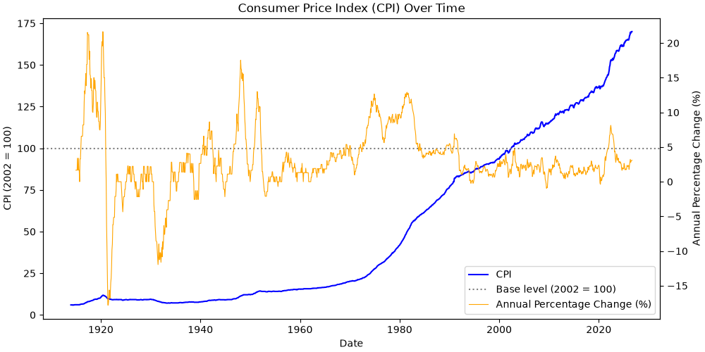

# FINE3300-2026-A2

FINE 3300 (Python for Finance Professionals) – Assignment 2, Part B: Consumer Price Index

## Introduction

The Consumer Price Index (CPI) measures the price level of a basket of goods and services bought by Canadian households. Statistics Canada publishes it every month, and changes in the CPI are used to measure inflation.

This project uses the monthly CPI data behind the Bank of Canada's [Inflation Calculator](https://www.bankofcanada.ca/rates/related/inflation-calculator/) (January 1914 to September 2026, 2002 = 100) to do three things:

1. Read the data into a Pandas data frame and graph the CPI together with its annual percentage change.
2. Build an enhanced version of the Bank of Canada Inflation Calculator. The Bank of Canada's calculator only takes a year, even though the data is monthly, so this calculator takes a month and year for each period and validates every input.

## Files

| File | Description |
|---|---|
| `cpi.csv` | Monthly Total CPI data downloaded from the Bank of Canada Inflation Calculator page (CSV format). |
| `cpi_graph.py` | Reads the data, calculates the annual percentage change, and creates the graph. |
| `cpi_graph.png` | The graph saved by `cpi_graph.py`. |
| `InflationCalculator.py` | Enhanced inflation calculator. Inputs: price, first date, second date (month and year). Uses the monthly CPI. |

## How to run the project

You need Python 3 with NumPy, Pandas, and Matplotlib.

```
git clone https://github.com/krishmalhotra7148-max/FINE3300-2026-A2.git
cd FINE3300-2026-A2
pip install numpy pandas matplotlib
```

Then run either program from inside the project folder (both read `cpi.csv` from the same folder):

```
python cpi_graph.py
python InflationCalculator.py
```

To use newer data, download the latest CSV from the Bank of Canada Inflation Calculator page and save it as `cpi.csv`.

## CPI graph



The blue line is the CPI (left axis), the orange line is the annual percentage change (right axis, each month compared with the same month a year earlier), and the dotted line is the base level of 100 (2002 = 100).

**Commentary**

- **The CPI was almost flat for its first 50 years, then took off.** It started at 6.0 in 1914 and has reached 170.0 in September 2026, but most of that increase happened after 1970. The CPI line crosses the base level in 2002, the base year.
- **The most volatile period was right after World War I.** Annual inflation peaked at 21.6% in June 1920 and was followed by the largest drop in the data, -17.8% in mid-1921. Prices fell again during the Great Depression in the early 1930s.
- **There was another spike after World War II**, reaching 17.5% in February 1948.
- **The 1970s and early 1980s were the longest stretch of high inflation.** The annual change averaged about 7.8% from 1970 to 1984 and peaked at 12.9% in July 1981. This is where the CPI line is steepest.
- **From 1992 to 2020 inflation was low and stable**, averaging about 1.8% a year. The only negative reading in this period was in 2009 (-0.9% in July) after the financial crisis.
- **The post-pandemic spike stands out**: 8.1% in June 2022, the highest reading since the early 1980s. The latest value in the data is 3.1% (September 2026).

## Calculator

The calculator uses the same formulas as the Bank of Canada:

- New price = price × (CPI in second period ÷ CPI in first period)
- Percent change = (CPI in second period ÷ CPI in first period − 1) × 100
- Annual rate of change = ((CPI in second period ÷ CPI in first period)^(1 ÷ number of years) − 1) × 100
- Number of years = number of months between the two dates ÷ 12

### Sample output

```
Enhanced Inflation Calculator (monthly CPI, January 1914 to September 2026)
Enter the price: $100
Enter the first date (YYYY-MM): 2000-03
Enter the second date (YYYY-MM): 2026-09
--------------------------------------------------
$100.00 CAD in March 2000 = $179.32 CAD in September 2026
--------------------------------------------------
Percent change:        79.32%
Number of years:       26.50
Annual rate of change: 2.23%
CPI in March 2000: 94.8
CPI in September 2026: 170.0
```

### Input validation

The calculator keeps asking until every input is valid:

```
Enter the price: $abc
  Please enter a number, e.g. 100 or 1,250.50
Enter the price: $100
Enter the first date (YYYY-MM): March 2020
  Please use the format YYYY-MM, e.g. 2020-03
Enter the first date (YYYY-MM): 1913-12
  The data only covers 1914-01 to 2026-09.
Enter the first date (YYYY-MM): 2020-03
```

- The price must be a number greater than 0 (commas and a dollar sign are accepted).
- Dates must be in `YYYY-MM` format with a real month.
- Dates must be inside the data set (January 1914 to September 2026).
- The dates can be entered in either order; entering the later date first shows what a price today was worth in the past.

## Data source

Bank of Canada, Inflation Calculator (Total CPI, monthly). Original source: Statistics Canada, Consumer Price Indexes for Canada, Monthly.